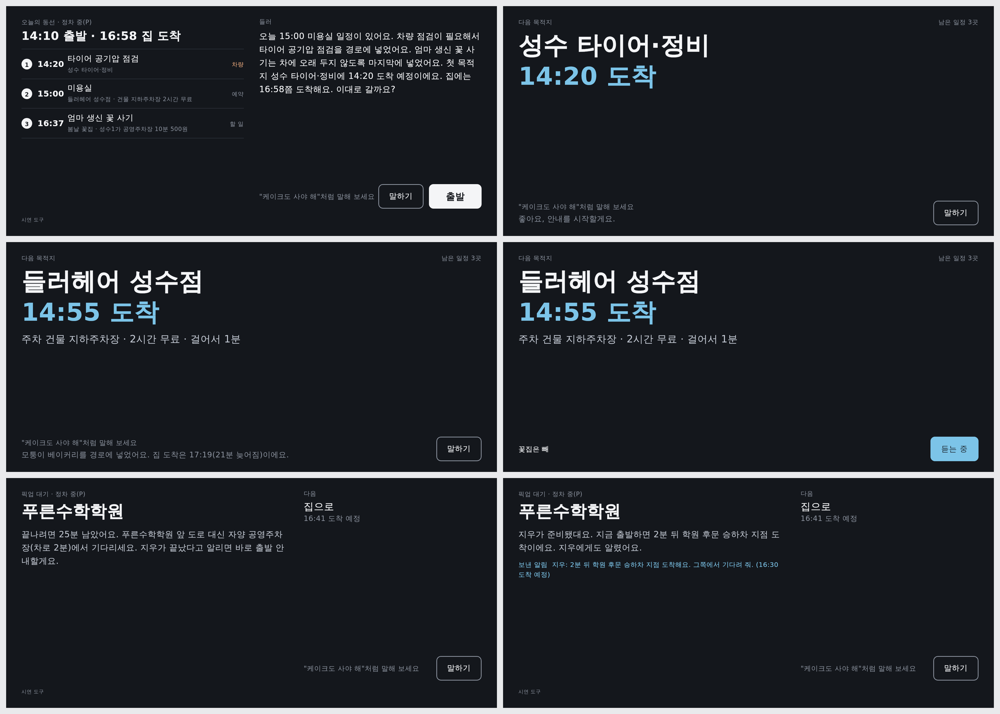
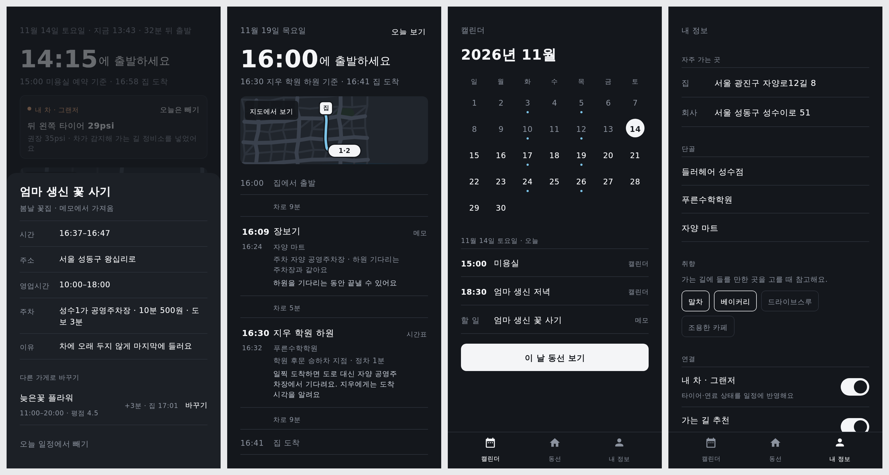

# 들러 (Deulleo · Stop by)

> 일정·동승자·차량 상태를 바탕으로 오늘의 이동 경로를 계획하고, 주행 중 음성으로 일정을 추가하거나 다시 계획할 수 있는 차량용 음성 에이전트입니다.

폰에서 정리한 일정과 볼일을 바탕으로 차량 탑승 시 가게·방문 순서·소요 시간·주차 정보가 포함된 경로를 제안합니다. 주행 중에는 말 한마디로 일정을 추가하거나 변경할 수 있습니다.

현재 프로토타입에서는 폰과 차량 사이의 실제 데이터 전송 대신, 두 앱이 공유하는 `core` 계획 로직과 시연용 데이터를 사용해 전체 흐름을 구현했습니다.

---

## 제출 정보

| 항목 | 내용 |
|---|---|
| 앱 이름 | 들러(Deulleo · Stop by) |
| 차량 앱 실행 | `./gradlew :app:installDebug` |
| 폰 앱 실행 | `./gradlew :mobile:installDebug` |
| 테스트 환경 | Pleos Connect Emulator v2.1.0, API 34, JDK 17 |
| 화면 규격 | 가로형 14.6인치·세로형 12.9인치 대응 |
| 레이아웃 검증 해상도 | 가로 1920×900, 세로 1200×1600 |
| 차량 앱 APK | `apk/들러_Deulleo_release.apk` |
| 폰 앱 APK | `apk/들러_Deulleo_mobile_release.apk` |

---

## 주요 기능

- 일정·할 일·차량 상태를 종합한 탑승 브리핑
- 예약 시간, 영업시간, 신선식품, 귀가 시각을 고려한 방문 순서 계산
- 지연이나 일정 추가에 따른 실시간 경로 재계획
- 다음 목적지·도착 시각·주차 정보 중심의 주행 화면
- 차량 기어, 경고등, 트렁크 상태에 따른 안내
- 하교 픽업 시 대기 장소와 승하차 지점 안내
- Pleos SDK를 사용할 수 없을 때의 대체 시연 수단 제공

---

## 화면

### 차량 앱



탑승 브리핑, 주행, 음성 일정 추가, 음성 인식, 픽업 대기, 픽업 출발 안내 화면입니다.

실제 `app` 모듈의 Compose UI를 렌더링한 화면이며, 주행 중에는 운전에 필요한 다음 목적지·도착 시각·주차 정보만 표시합니다.

### 폰 앱




일정을 모으고 오늘의 동선을 미리 확인하는 앱입니다. 차량 앱과 동일한 `core` 에이전트를 사용해 경로를 계획합니다.

| 화면 | 주요 기능 |
|---|---|
| 동선(홈) | 권장 출발 시각, 차량 알림, 동선 지도, 시간표 표시 |
| 일정 상세 | 시간·주소·영업시간·주차·추천 이유 확인, 방문 장소 변경 |
| 추가 | 품목 직접 입력, 예약 문자 스크린샷에서 일정 가져오기 |
| 동선 지도 | 가상 도로망 기반 경로, 순서 핀, 차에서 이어서 안내 |
| 차로 넘기기 | 탑승 시 제공할 브리핑 미리보기 |
| 캘린더 | 날짜별 동선 확인, 화·목요일 학원 하원 픽업 일정 제공 |
| 내 정보 | 집·회사·단골 장소, 취향, 차량 연결과 경로 추천 설정 |

---

## 시연 시나리오

차량이 정차한 상태에서 화면 하단의 **시연 도구**를 이용해 두 시나리오를 전환할 수 있습니다.

- `[하교 픽업으로]`
- `[주말 볼일로]`

### A. 주말 볼일

출발 시각은 14:10이며, 15:00 미용실 예약과 꽃 구매 일정이 있는 상황입니다.

| 단계 | 차량 상태 | 들러의 동작 |
|---|---|---|
| 탑승 브리핑 | 시동 후 P단 | 오늘 일정, 할 일, 타이어 경고를 종합해 방문 계획을 음성으로 제안 |
| 출발 | “응” 또는 `[출발]` | NaviHelper로 목적지와 최대 2개의 경유지를 전달하고 주행 화면으로 전환 |
| 도착 | 내비 도착 이벤트 또는 근접 알림, P단 | 주차장에서 가게까지의 도보 안내 표시 |
| 재출발 | P → D | 현재 볼일을 완료 처리하고 다음 구간 안내 |
| 지연 | “40분 늦을 것 같아” | 시연용 장소 카탈로그에서 영업 가능한 같은 업종의 장소를 찾아 재계획 |
| 일정 추가 | “케이크도 사야 해” | 동선에 맞는 빵집을 추가하고, 장소가 인접하면 “주차는 한 번만”이라고 안내 |
| 트렁크 | 방문 장소에서 트렁크 열림 → 닫힘 | 물건을 실은 것으로 판단해 일정을 완료 처리하고 다음 일정 안내 |

### B. 평일 하교 픽업

출발 시각은 15:50이며, 16:30에 지우의 학원 하원 일정이 있는 상황입니다.

| 단계 | 들러의 동작 |
|---|---|
| 탑승 브리핑 | “16:30에 지우 학원 하원이 있어요. 일찍 도착하면 도로 대신 자양 공영주차장에서 기다리시면 돼요.” |
| 일찍 도착 | 학원 앞 도로 정차 대신 대기 장소를 안내하고, 시간이 충분하면 근처 장보기를 제안 |
| 준비 신호 | `[아이: 끝났어]` 버튼 또는 “지우 끝났대” 발화를 받으면 후문 승하차 지점 도착 시각을 안내 |

---

## 폰 앱 시연 순서

약 1분 분량의 시연 흐름입니다.

1. 홈에서 권장 출발 시각, 차량 알림, 일정별 추천 이유를 확인합니다.
2. `추가 → 스크린샷에서 가져오기 → 동선에 넣기`를 선택합니다.
3. 케이크 픽업 일정이 추가되고 꽃집이 빵집 옆 장소로 변경되는 것을 확인합니다.
4. 귀가 예상 시각이 `16:58 → 17:33`으로 변경되는 것을 확인합니다.
5. `지도에서 보기 → 차에서 이어서 안내`를 선택합니다.
6. `캘린더 → 19일(목) → 이 날 동선 보기`에서 학원 하원 픽업과 대기 주차장을 확인합니다.

---

## 프로젝트 구조

```text
deulleo/
├── core/   순수 Kotlin 모듈 — Android 의존 없이 JVM 단위 테스트 실행
│   ├── DeulleoAgent.kt
│   │   └── 탑승 브리핑, 사용자 발화 처리, 경로 재계획
│   ├── planner/RoutePlanner
│   │   └── 예약·영업시간·신선식품·귀가 시각 제약을 고려한 순서 최적화
│   ├── planner/PlaceCatalog
│   │   └── 장소 검색 인터페이스 및 시연용 가상 장소
│   ├── voice/IntentParser
│   │   └── 한국어 규칙 기반 의도 파서
│   └── vehicle/VehicleRules
│       └── 차량 상태에 따른 관리 일정과 UI 모드 판단
│
├── app/    Pleos Connect 차량 앱 — Kotlin, Jetpack Compose, minSdk 28
│   ├── pleos/PleosVehicleSource
│   │   └── Vehicle SDK: 기어·연료·배터리·경고등·트렁크 상태
│   ├── pleos/PleosNavigator
│   │   └── NaviHelper SDK: 경유지 경로 요청 및 도착 이벤트
│   ├── pleos/PleosVoice
│   │   └── SpeechToText·TextToSpeech SDK, ko-KR
│   ├── pleos/PleosLocation
│   │   └── FusedLocation SDK: 현재 위치 및 근접 알림
│   ├── MainViewModel.kt
│   │   └── 차량 이벤트·에이전트·화면 연결
│   ├── ui/Screens.kt
│   │   └── 관리·탑승 브리핑·주행·도착 화면
│   └── assets/gleo_app_schema.json
│       └── Gleo Interface App Schema, 함수 3개
│
├── mobile/ 폰 앱 — Kotlin, Jetpack Compose
│   └── 일정 수집, 동선 지도, 캘린더, 사용자 설정
│
└── apk/    제출용 차량 앱·폰 앱 APK
```

---

# 실행 방법

## 1. 개발 환경

다음 환경이 필요합니다.

- Android Studio 최신 안정 버전
- JDK 17
- Android API 28 이상
- Gradle Wrapper 8.11.1
- Android Gradle Plugin 8.7.3
- Kotlin 2.0.21

별도의 Gradle 설치 없이 저장소에 포함된 Gradle Wrapper를 사용합니다.

Pleos Connect SDK는 `settings.gradle.kts`에 등록된 Pleos Maven 저장소에서 자동으로 내려받습니다.

---

## 2. Pleos Connect Emulator 준비

차량 앱 실행에는 Pleos Connect Emulator가 필요합니다. 폰 앱은 일반 Android 기기 또는 Android Emulator에서 실행할 수 있습니다.

### System Image 저장소 등록

Android Studio에서 다음 메뉴로 이동합니다.

`Tools → SDK Manager → SDK Update Sites → +`

운영체제에 맞는 저장소를 등록합니다.

#### Windows·Linux

```text
Name: Pleos Connect System Image
URL: https://nexus-playground.pleos.ai/repository/raw-releases/connect-avd/2.x/crp-sys-img.xml
```

#### macOS

```text
Name: Pleos Connect System Image
URL: https://nexus-playground.pleos.ai/repository/raw-releases/connect-avd/2.x/crp-arm64-sys-img.xml
```

### Emulator 생성

1. `SDK Platforms`에서 API 34의 **Pleos Connect System Image**를 설치합니다.
2. Android Studio를 다시 시작합니다.
3. `Device Manager → Create device`를 선택합니다.
4. Form Factor에서 **Automotive**를 선택합니다.
5. **Pleos Connect v2.1.0** 이미지를 선택합니다.
6. RAM을 4GB로 설정합니다.
7. AVD 설정의 Boot option을 반드시 **Cold boot**로 설정합니다.

Quick boot로 실행하면 차량 신호인 VHAL이 정상적으로 올라오지 않아 기어와 경고등 값을 받지 못할 수 있습니다.

### 음성 입력 설정

음성 인식을 사용하려면 다음 설정을 활성화합니다.

`Extended Controls → Microphone → Virtual microphone uses host audio input`

Pleos 문서 기준으로 에뮬레이터 실행에는 외장 GPU가 필요하며, 최소 권장 사양은 RTX 3060 Laptop 6GB입니다.

---

## 3. 앱 빌드 및 설치

### 차량 앱

Pleos Connect Emulator를 실행한 뒤 다음 명령을 사용합니다.

```bash
./gradlew :app:installDebug
```

### 폰 앱

일반 Android 기기나 Android Emulator에 설치합니다. Pleos Connect Emulator는 필요하지 않습니다.

```bash
./gradlew :mobile:installDebug
```

### 차량 앱 release 빌드

```bash
./gradlew :app:assembleRelease
```

직접 빌드한 APK는 다음 Gradle 출력 디렉터리에 생성됩니다.

```text
app/build/outputs/apk/release/
```

---

## 4. 차량 앱 시연

### 권장 실행 순서

1. Pleos Connect Emulator를 Cold Boot로 실행합니다.
2. 차량 앱을 설치합니다.
3. ADB 포트 포워딩을 설정합니다.
4. Virtual Console에 접속합니다.
5. 기어를 P로 설정합니다.
6. 차량 앱을 실행합니다.

### Virtual Console 연결

```bash
adb forward tcp:8088 tcp:8088
```

브라우저에서 다음 주소에 접속합니다.

```text
http://127.0.0.1:8088/
```

### 기본 시연

1. Virtual Console에서 기어를 **P**로 설정합니다.
2. 앱을 열면 탑승 브리핑이 시작됩니다.
3. `[출발]` 버튼을 누르거나 마이크로 “응”이라고 말합니다.
4. 기어를 **D**로 변경합니다.
5. 앱이 주행 화면으로 전환되는지 확인합니다.

### 차량 신호 시연

- `Telltales → TPMS`를 활성화하면 탑승 브리핑에 타이어 점검 일정이 추가됩니다.
- `Trunk Position`을 열면 트렁크 관련 안내가 표시됩니다.
- 화면 하단의 **시연 도구**에서 타이어 경고를 직접 전환할 수 있습니다.
- 마이크를 사용할 수 없을 때는 발화를 직접 입력할 수 있습니다.
- 내비 도착 이벤트를 사용할 수 없을 때는 `[도착 처리]`를 사용할 수 있습니다.

시연 도구 하단의 **연결 상태** 영역에는 다음 SDK의 연결 상태와 실패 원인이 표시됩니다.

- 차량 신호
- 내비게이션
- 음성 인식
- 음성 안내
- 위치

---

# 테스트 환경 및 설정

## 테스트 환경

| 항목 | 값 |
|---|---|
| Pleos Connect Emulator | v2.1.0 |
| Android API | 34 |
| 지원 화면 형태 | 가로형 14.6인치, 세로형 12.9인치 |
| 레이아웃 검증 해상도 | 가로 1920×900, 세로 1200×1600 |
| 검증 방식 | Pleos Emulator 실행 및 Compose 렌더링 확인 |
| minSdk / targetSdk | 28 / 34 |
| JDK | 17 |
| Gradle Wrapper | 8.11.1 |
| Android Gradle Plugin | 8.7.3 |
| Kotlin | 2.0.21 |

화면 크기와 방향에 따라 레이아웃이 변경되도록 구성했습니다.

## Pleos SDK 버전

| SDK | 버전 |
|---|---:|
| Vehicle | 2.3.2 |
| NaviHelper | 3.0.5 |
| SpeechToText | 3.3.1 |
| TextToSpeech | 3.3.1 |
| FusedLocation | 1.1.3 |

---

## 선택 설정

Pleos Playground의 My Project 자격 증명이 있으면 프로젝트 루트의 `local.properties`에 다음 값을 추가할 수 있습니다.

```properties
pleos.clientId=...
pleos.clientSecret=...
```

- 자격 증명이 있으면 STT·TTS를 `HYBRID` 모드로 실행합니다.
- 자격 증명이 없으면 `ON_DEVICE` 모드로 실행합니다.
- `local.properties`는 Git에 포함되지 않습니다.

---

## release 서명 설정

배포용 서명 키를 사용하려면 `keystore.properties`를 추가합니다.

서명 설정이 없으면 release 변형을 디버그 키로 서명해 설치 가능한 APK를 생성합니다. 이 방식으로 생성된 APK는 심사와 시연용이며 실제 배포용으로 사용하면 안 됩니다.

---

## 권한

`app/src/main/AndroidManifest.xml`에 다음 Pleos 권한을 선언했습니다.

```text
CAR_DRIVE
CAR_ENERGY
CAR_SAFETY
CAR_DOORS
NAVI_ROUTE
NAVI_ROUTE_SEARCH
STT_SERVICE
TTS_SERVICE
FUSED_LOCATION
```

이 앱은 차량 상태 조회 권한만 사용하며 차량 제어 권한은 사용하지 않습니다.

Pleos 권한은 Pleos App Market과 사전에 협의하고 승인받은 범위에서만 사용할 수 있습니다.

---

# SDK를 사용할 수 없을 때의 동작

Pleos Playground의 My Project 화면 기준으로 Vehicle State와 NaviHelper는 사용할 수 있지만, SpeechToText·TextToSpeech·FusedLocation은 준비 중으로 표시될 수 있습니다.

일부 SDK에 연결하지 못하더라도 앱과 시연 흐름이 중단되지 않도록 대체 동작을 구현했습니다.

| SDK | 연결 실패 시 대체 동작 |
|---|---|
| TextToSpeech | Android 기본 음성 합성으로 안내 |
| SpeechToText | 시연 도구의 발화 직접 입력 사용 |
| FusedLocation | NaviHelper 도착 이벤트 또는 시연 도구의 도착 처리 사용 |
| Vehicle | 시연 도구의 스위치로 타이어 경고 상태 재현 |

---

# 테스트

## 에이전트 및 경로 계획 테스트

Android SDK 없이 JVM에서 실행할 수 있습니다.

```bash
./gradlew -Pcore.only :core:test
```

다음 항목을 검증합니다.

- 탑승 브리핑 생성
- 방문 순서 계산
- 예약 시간과 영업시간 제약
- 일정 추가와 재계획
- 지연에 따른 장소 변경
- 한국어 발화 의도 해석
- 차량 상태에 따른 UI 모드 판단

## 폰 앱 테스트

```bash
./gradlew :mobile:testDebugUnitTest
```

다음 사용자 흐름을 단계별로 검증합니다.

- 일정 추가
- 중복 일정 추가 방지
- 찾을 수 없는 품목 처리
- 스크린샷 일정 추가
- 일정 제외 및 다시 추가
- 방문 장소 변경
- 추천 일정 추가
- 차량 연결 설정
- 하교 픽업 일정
- 일정이 없는 날짜
- 뒤로 가기 동작

---

# APK 파일

바로 설치할 수 있는 제출용 APK는 저장소의 `apk/` 폴더에 있습니다.

| 앱 | APK 위치 |
|---|---|
| 차량 앱 | `apk/들러_Deulleo_release.apk` |
| 폰 앱 | `apk/들러_Deulleo_mobile_release.apk` |

직접 빌드한 차량 앱 APK는 `app/build/outputs/apk/release/`에 생성됩니다.

---

# 구현 범위

## 실제로 동작하는 기능

- `core` 에이전트 기반의 경로 계획 및 재계획
- 예약 시간·영업시간·신선식품·귀가 시각을 고려한 방문 순서 계산
- 직접 입력을 통한 일정 추가
- 일정 제외 및 다시 추가
- 방문 장소 변경
- 추천 일정 추가
- 변경 전후 귀가 시각 계산
- 차량 연결 설정 반영
- 차량 상태에 따른 화면 모드 변경
- Pleos SDK 연결 및 연결 실패 시 대체 동작
- 차량 앱과 폰 앱이 동일한 `core` 계획 로직 사용

## 시연용 데이터 또는 미연동 기능

- 가게와 주차장은 가상 데이터입니다.
- 지도는 앱 내부에서 그린 가상 도로망입니다.
- 스크린샷 인식은 정해진 샘플 문자 한 건으로 흐름을 보여 줍니다.
- 타이어 수치, 현재 시각, 날짜는 시연을 위해 고정했습니다.
- 폰 앱의 `차에서 이어서 안내`는 화면 흐름만 구현되어 있으며 실제 차량 전송은 하지 않습니다.
- 지연 시 장소 변경은 시연용 장소 카탈로그 안에서 같은 업종의 영업 가능한 장소를 검색합니다.

---

# 보안 메모

- 저장소에는 키나 비밀번호를 포함하지 않습니다.
- `local.properties`, `keystore.properties`, `*.jks`는 `.gitignore`에 포함되어 있습니다.
- `pleos.clientSecret`은 빌드 과정에서 APK에 포함되므로 APK에서 추출될 수 있습니다.
- 프로토타입에서는 이를 허용하지만, 출시 전에는 서버를 통해 단기 자격 증명을 발급하는 구조로 변경해야 합니다.
- 별도 서명 키가 없으면 release 변형을 디버그 키로 서명합니다.
- 사용자 입력은 앞뒤 공백을 제거하고 최대 길이를 제한합니다.

---

# 현재 상태와 다음 단계

## 완료

- 에이전트 핵심 로직
- 방문 순서 계획 및 재계획
- 한국어 규칙 기반 의도 해석
- 핵심 로직 단위 테스트
- Pleos SDK 5종 연동 코드
- 관리·탑승 브리핑·주행·도착 화면
- 폰 앱의 일정·지도·캘린더·사용자 설정 화면

## 다음 단계

- 시연용 장소 검색을 카카오 로컬 API로 교체
  - 키워드 검색
  - 카테고리 검색
  - 주차장 카테고리 `PK6`
- 규칙 기반 의도 해석을 LLM Function Calling으로 교체
- 실제 캘린더 연동
- 스크린샷 공유를 통한 일정 자동 인식
- 폰 앱과 차량 앱의 서버 동기화
- Gleo Interface 등록 및 Action 수신 처리
- 기어 조회를 deprecated API에서 표준 `GEAR_SELECTION` 속성으로 이전
