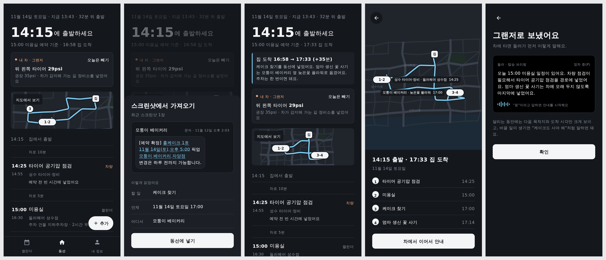

# 들러 (Deulleo · Stop by)

> 사용자의 일정·동승자·차 상태를 읽고, 오늘의 이동을 그 사람 상황에 맞게 설계하는 차량용 음성 에이전트.
> 폰에서 모은 일정과 볼일을 차에 타는 순간 가게·순서·시간·주차까지 정리된 경로로 바꾸고, 주행 중에는 말 한마디로 다시 짭니다.

현대자동차그룹 차량용 앱 개발 공모전(Pleos Connect) 출품작의 프로토타입입니다.

### 차량 앱 화면


탑승 브리핑 · 주행 · 음성으로 추가한 뒤 · 듣는 중 · 픽업 대기 · 픽업 출발 안내.
실제 Compose 코드를 렌더링한 화면이며, 주행 중에는 다음 목적지·도착 시각·주차 세 가지만 보여 줍니다.

## 시연 시나리오

정차 중 화면 하단 **시연 도구**의 [하교 픽업으로] / [주말 볼일로] 버튼으로 두 시나리오를 바꿀 수 있습니다.

### A. 주말 볼일 (14:10 출발)

| 단계 | 차량 상태 | 들러의 동작 |
|---|---|---|
| 탑승 브리핑 | 시동 후 P단 | 오늘 일정(15:00 미용실)·할 일(꽃 사기)·차량 경고(타이어)를 묶어 계획을 세우고 음성으로 제안 |
| 출발 | "응" / [출발] | NaviHelper로 목적지 + 경유지(최대 2곳) 안내 시작 → 화면이 **주행 모드**로 전환 |
| 도착 | 내비 도착 이벤트·근접 알림 + P단 | **도착 모드**: 주차장에서 가게까지 도보 안내 |
| 재출발 | P → D | 현재 볼일 완료 처리, 다음 구간 안내 |
| 지연 | "40분 늦을 것 같아" | 마감 시간이 안 맞는 가게를 같은 업종의 다른 가게로 바꿔 재계획 |
| 추가 | "케이크도 사야 해" | 동선에 맞는 빵집을 넣고, 이웃한 볼일이면 "주차는 한 번만" 안내 |
| 트렁크 | 볼일 장소에서 트렁크 열림 → 닫힘 | 물건을 실은 것으로 보고 완료 처리 + 다음 일정 안내 |

### B. 평일 하교 픽업 (15:50 출발, 16:30 학원 하원)
| 단계 | 들러의 동작 |
|---|---|
| 탑승 브리핑 | "16:30에 지우 학원 하원이 있어요. 일찍 도착하면 도로 대신 자양 공영주차장에서 기다리시면 돼요." |
| 일찍 도착 | 학원 앞 도로 정차 대신 대기 지점 안내, 남은 시간이 충분하면 근처 볼일(장보기) 제안 |
| 준비 신호 | 아이 폰의 "끝났어"(시연: [아이: 끝났어] 버튼 또는 "지우 끝났대") → "2분 뒤 후문 승하차 지점 도착" 안내 + 아이에게 도착 알림 |

## 프로젝트 구조

```
deulleo/
├── core/   순수 Kotlin(안드로이드 의존 없음) — JVM에서 단위 테스트
│   ├── DeulleoAgent.kt        에이전트: 브리핑, 발화 처리, 재계획
│   ├── planner/RoutePlanner   순서 최적화(전수 탐색 + 예약·영업시간·신선식품·귀가 시각 제약)
│   ├── planner/PlaceCatalog   장소 검색 인터페이스 + 시연용 샘플(가상 가게)
│   ├── voice/IntentParser     한국어 규칙 기반 의도 파서(→ 서비스 단계에서 LLM 도구 호출로 교체)
│   └── vehicle/VehicleRules   차량 상태 → 차량 관리 할 일, UI 모드 판단
├── app/    Pleos Connect 차량 앱 (Kotlin, Jetpack Compose, minSdk 28)
│   ├── pleos/PleosVehicleSource  Vehicle SDK: Gear·Fuel·EvBattery·Safety(경고등)·Door(트렁크)
│   ├── pleos/PleosNavigator      NaviHelper SDK: requestRouteWithWaypoints, 도착 이벤트
│   ├── pleos/PleosVoice          SpeechToText / TextToSpeech SDK (ko-KR)
│   ├── pleos/PleosLocation       FusedLocation SDK: 현재 위치, 근접 알림
│   ├── MainViewModel.kt          차량 이벤트 ↔ 에이전트 ↔ 화면 연결
│   ├── ui/Screens.kt             관리 / 탑승 브리핑 / 주행 / 도착 4가지 화면
│   └── assets/gleo_app_schema.json  Gleo Interface App Schema(함수 3개)
├── mobile/ 폰 앱 (Kotlin, Jetpack Compose) — 일정 모으기, 동선 지도, 캘린더, 내 정보
└── apk/    제출용 release APK
```

## 폰 앱 (`mobile` 모듈)




일정을 모으고 오늘의 동선을 미리 확인하는 폰 앱입니다. 차량 앱과 같은 `core` 에이전트로 계획을 세웁니다.
위 그림은 시안이 아니라 실제 Compose 코드를 렌더링한 화면입니다.

| 화면 | 내용 |
|---|---|
| 동선(홈) | 몇 시에 출발하면 되는지, 차량 알림(타이어 공기압), 동선 지도, 시간표. 일정마다 주차·이유·출처가 붙습니다 |
| 일정 상세 | 시간·주소·영업시간·주차·이유, 다른 가게로 바꾸기(바꾸면 귀가가 몇 분 달라지는지 표시) |
| 추가 | 품목만 적으면 동선에 맞는 가게를 찾아 넣기, 예약 문자 스크린샷에서 가져오기 |
| 동선 지도 | 도로를 따라가는 경로와 번호 핀, [차에서 이어서 안내] |
| 차로 넘기기 | 차에 타면 들릴 탑승 브리핑 미리보기 |
| 캘린더 | 날짜를 고르면 그날 동선으로 이동(화·목은 학원 하원 픽업) |
| 내 정보 | 집·회사·단골, 취향, 차량 연결과 가는 길 추천 켜기/끄기 |

```bash
./gradlew :mobile:installDebug   # 일반 안드로이드 폰·에뮬레이터에 설치 (Pleos 에뮬레이터 불필요)
```

### 시연 순서 (약 1분)
1. 홈: "14:15에 출발하세요", 차량 알림, 일정별 이유 확인
2. 추가 → 스크린샷에서 가져오기 → 동선에 넣기: 케이크 픽업이 들어가고, 꽃집이 빵집 옆 가게로 옮겨지며 "집 도착 16:58 → 17:33"이 표시됩니다
3. 지도에서 보기 → 차에서 이어서 안내
4. 캘린더 → 19일(목) → 이 날 동선 보기: 학원 하원 픽업과 대기 주차장

### 실제로 동작하는 것과 시연용인 것
- 동작: 계획·재계획(순서, 시각, 가게 교체, 귀가 시각 변화)은 `core` 에이전트가 실제로 계산합니다. 직접 입력으로 추가, 일정 빼기, 가게 바꾸기, 추천 넣기, 차량 연결 끄기가 모두 계획에 반영됩니다.
- 시연용: 가게·주차장은 가상 데이터이고, 지도는 앱이 그린 가상 도로망입니다. 스크린샷 인식은 정해진 샘플 문자 한 건으로 흐름만 보여 주며, 타이어 수치·현재 시각·날짜는 고정값입니다. 차로 보내기는 화면만 있고 실제 전송은 하지 않습니다.
- 다음 단계: 카카오맵 SDK·길찾기 API, 멀티모달 LLM 인식, 서버 동기화로 교체합니다.

## 실행 방법

### 1. 개발 환경
- Android Studio 최신 버전, JDK 17
- Android API 28 이상, Gradle 8.0 이상(래퍼: Gradle 8.11.1, AGP 8.7.3, Kotlin 2.0.21)
- Pleos Connect SDK는 `settings.gradle.kts`에 등록된 Pleos Maven 저장소에서 자동으로 받습니다.

### 2. Pleos Connect Emulator 준비
1. Android Studio → Tools → SDK Manager → SDK Update Sites에서 `+`
   - Name: `Pleos Connect System Image`
   - URL(Windows/Linux): `https://nexus-playground.pleos.ai/repository/raw-releases/connect-avd/2.x/crp-sys-img.xml`
   - URL(Mac): `https://nexus-playground.pleos.ai/repository/raw-releases/connect-avd/2.x/crp-arm64-sys-img.xml`
2. SDK Platforms → API 34의 **Pleos Connect System Image** 설치 후 Android Studio 재시작
3. Device Manager → Create device → Form Factor **Automotive** → **Pleos Connect v2.1.0** → RAM 4GB
4. AVD 설정의 Boot option을 반드시 **Cold boot**로 둡니다. Quick boot로 켜면 차량 신호(VHAL)가 올라오지 않아 기어·경고등 값을 받지 못합니다.
5. 음성 인식을 쓰려면 에뮬레이터 Extended Controls → Microphone에서 **Virtual microphone uses host audio input**을 켭니다.

에뮬레이터는 외장 GPU가 필요합니다(Pleos 문서 기준 최소 RTX 3060 Laptop 6GB).

### 3. 빌드·설치
```bash
./gradlew :app:installDebug          # 에뮬레이터에 설치
./gradlew :app:assembleRelease       # release APK → app/build/outputs/apk/release/
./gradlew -Pcore.only :core:test     # 에이전트·경로 계획 단위 테스트(안드로이드 SDK 불필요)
```

### 4. 시연 (Virtual Console)
```bash
adb forward tcp:8088 tcp:8088        # 브라우저에서 http://127.0.0.1:8088/
```
- Virtual Console에서 **기어 P**로 두고 앱을 열면 탑승 브리핑이 나옵니다.
- [출발] 또는 마이크 → "응" → 기어 **D**로 바꾸면 주행 모드로 전환됩니다.
- Virtual Console의 **Telltales → TPMS**를 켜면 출발 전 브리핑에 타이어 점검 일정이 들어갑니다. **Trunk Position**을 열면 트렁크 안내가 나옵니다.
- 정차 중 화면 하단 **시연 도구**: 타이어 경고 스위치, 도착 처리, 발화 직접 입력(마이크나 음성 인식을 쓸 수 없을 때)
- 시연 도구 맨 아래의 **연결 상태** 줄에 SDK별 상태(차량 신호, 내비, 음성 인식, 음성 안내, 위치)가 나옵니다. 연결에 실패하면 이유가 그대로 표시됩니다.

### 5. SDK를 쓸 수 없을 때의 동작
Pleos Playground의 My Project 화면 기준으로 Vehicle State와 NaviHelper는 바로 쓸 수 있고, SpeechToText·TextToSpeech·FusedLocation은 "준비 중"으로 표시됩니다. 그래서 각 SDK가 없어도 앱이 멈추지 않게 했습니다.

| SDK | 연결 실패 시 |
|---|---|
| TextToSpeech | 안드로이드 기본 음성 합성으로 대신 읽습니다 |
| SpeechToText | 시연 도구의 발화 직접 입력으로 같은 흐름을 진행합니다 |
| FusedLocation | 도착은 NaviHelper의 도착 이벤트와 시연 도구의 도착 처리로 판단합니다 |
| Vehicle | 시연 도구의 스위치로 타이어 경고를 흉내 냅니다 |

## 테스트 환경 및 필요한 설정

| 항목 | 값 |
|---|---|
| Pleos Connect Emulator | v2.1.0 (API 34) |
| 화면 규격 | _(제출 전 기재: AVD 설정의 해상도)_ 가로형·세로형(12.9인치) 모두 배치가 바뀌도록 구성 |
| minSdk / targetSdk | 28 / 34 |
| Pleos SDK | Vehicle 2.3.2, NaviHelper 3.0.5, SpeechToText 3.3.1, TextToSpeech 3.3.1, FusedLocation 1.1.3 |

선택 설정 (`local.properties`, git에 올리지 않음):
```properties
pleos.clientId=...       # Pleos Playground My Project 자격 증명
pleos.clientSecret=...   # 있으면 STT/TTS를 HYBRID(서버 우선) 모드로, 없으면 ON_DEVICE 모드로 실행
```

release 서명 키(선택, `keystore.properties`): 없으면 디버그 키로 서명한 설치 가능한 release APK가 만들어집니다.

### 권한
`app/src/main/AndroidManifest.xml`에 선언한 Pleos 권한: `CAR_DRIVE`, `CAR_ENERGY`, `CAR_SAFETY`, `CAR_DOORS`,
`NAVI_ROUTE`, `NAVI_ROUTE_SEARCH`, `STT_SERVICE`, `TTS_SERVICE`, `FUSED_LOCATION`.
Pleos 퍼미션은 Pleos App Market과 사전 협의·승인된 범위에서만 사용할 수 있습니다(이 앱은 조회 권한만 쓰고 차량 제어 권한은 쓰지 않습니다).

## APK 파일 위치
`apk/성명_Deulleo_release.apk` _(제출 전 `assembleRelease` 결과물을 이 이름으로 복사)_

## 테스트

```bash
./gradlew -Pcore.only :core:test    # 에이전트·경로 계획·발화 해석 13개
./gradlew :mobile:testDebugUnitTest # 폰 앱 사용자 흐름 13개
```

폰 앱 테스트는 핵심 흐름(추가, 중복 추가, 없는 품목, 스크린샷 추가, 빼기·다시 넣기, 가게 바꾸기, 추천, 차량 연결, 픽업일, 빈 날, 뒤로 가기)을 단계별로 따라갑니다.

## 보안 메모
- 저장소에는 키·비밀번호가 없습니다. `local.properties`, `keystore.properties`, `*.jks`는 `.gitignore`에 있습니다.
- `pleos.clientSecret`은 빌드 때 APK 안에 들어가므로 APK를 받으면 꺼낼 수 있습니다. 프로토타입에서는 허용하되, 출시 전에는 서버를 거쳐 발급받는 방식으로 바꿔야 합니다.
- 자격 증명이 없으면 서명 키 없이 디버그 키로 서명한 release APK가 만들어집니다. 시연용으로만 쓰세요.
- 사용자 입력(추가할 품목, 시연 도구의 발화)은 앞뒤 공백을 지우고 길이를 제한합니다.

## 현재 범위와 다음 단계
- ✅ 에이전트 핵심 로직(계획·재계획·의도 해석) + 단위 테스트
- ✅ Pleos SDK 5종 연동 코드, 4가지 화면 모드
- ⏳ 장소 검색: 시연용 가상 가게 → 카카오 로컬 API(키워드·카테고리, 주차장 PK6)로 교체
- ⏳ 의도 해석: 규칙 기반 → LLM 도구 호출(function calling)
- ⏳ 폰 앱: 캘린더 연동, 스크린샷 공유 → 일정 자동 인식, 서버 동기화
- ⏳ Gleo Interface 등록(`assets/gleo_app_schema.json`) 및 Action 수신 처리
- ⏳ 기어 조회를 표준 `GEAR_SELECTION` 속성으로 이전(Pleos Gear API deprecated)
